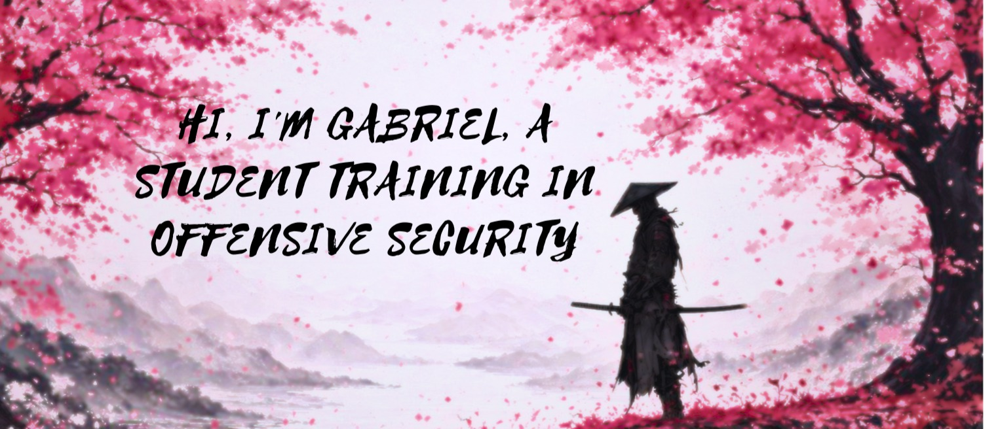

 

Estudiante de Ingeniería en Sistemas en Quito, Ecuador. Desarrollo software y construyo bases sólidas en redes, infraestructura y sistemas, con interés a largo plazo en <strong>pentesting y seguridad de redes</strong>.

---

## Technical foundations

 

**Languages:** Python, C#, Java, C++, Go, JavaScript, SQL, HTML and CSS.  
**Frameworks:** .NET / ASP.NET Core, Angular, React, FastAPI, SQLModel and JavaFX.  
**Cloud & DevOps:** AWS, Azure, Docker, Kubernetes, CI/CD, Git and Azure DevOps.  
**Systems & networks:** Linux, MikroTik, pfSense, Zabbix, routing and network design.  
**Security:** vulnerability analysis, network security, digital forensics and URL analysis.

---

## Featured projects

### 🧪 [SQLi Studio — SQLi and Recon Tool](https://github.com/LeirBaGMC/SQLi-And-Recon-Tool)
Educational web security tool with a controlled lab for demonstrating SQL injection and validating fixes. Presented as a workshop at **TICEC 2026**.

`Go` `React` `Docker` `Web security`

### 🛡️ [Campus Network Architecture (RPi)](https://github.com/LeirBaGMC/Campus-Network-Architecture-RPi)
Multi-VLAN campus network architecture using Raspberry Pi as a core router, with VLSM planning, redundancy, and integrated services.

`Networking` `VLANs` `Raspberry Pi` `OpenWrt`

### 🔍 [RUCKUS Security Research](https://github.com/LeirBaGMC/RUCKUS-Security-Research)
Academic research into wireless network risks, configuration review, security hardening, and mitigation planning.

`Cybersecurity` `Wireless` `Risk analysis`

### 🖼️ [Visual Vault](https://github.com/LeirBaGMC/Visual-Vault)
Full-stack visual discovery platform for organizing and sharing images, with automated content moderation.

`React` `FastAPI` `AWS S3` `Rekognition`

### ♻️ [EcoRAEE](https://github.com/LeirBaGMC/EcoRAEE)
Backend features for electronic waste management, including device and batch workflows, permissions, audit records, and SQL Server persistence.

`Python` `FastAPI` `SQL Server` `AWS`

### 🗓️ [Turno Fácil](https://github.com/os-devsec/Turno-Facil)
Team project: contribution to a shift-management application.

`Software development` `Team collaboration`

---

## Experience & education

- **Software Developer Intern — Saludsa** · Quito · Sep 2026–present  
  Internal applications and services, API and database integration, issue analysis, Git, and Azure DevOps.
- **Technical Support Intern — Universidad Internacional del Ecuador (UIDE)** · 2024–2026  
  First-level IT support, lab standardization, and academic software deployment.
- **Systems Engineering — UIDE** · 2023–2028, in progress  
  Fifth semester; member of the Computer Science Students Association board in 2026.
- **Independent developer** · Academic and personal projects in software, databases, and cloud deployment.

---

## A little more

- 🇪🇨 Based in Quito, Ecuador
- 🗣️ Spanish (native) · English (B2)
- 🎓 Workshop presenter at TICEC 2026
- 💼 [LinkedIn](https://www.linkedin.com/in/gabriel-amindac/) · [Email](mailto:gabomindal@gmail.com)

---

 Contribution graph animation

