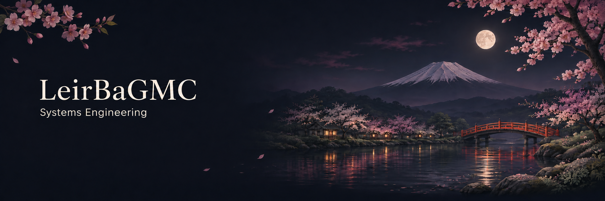

  

Systems Engineering student based in Quito, Ecuador. Interested in software development, networks, and technology infrastructure, with a long-term focus on cybersecurity and network security.

[GitHub](https://github.com/LeirBaGMC) · [LinkedIn](https://www.linkedin.com/in/gabriel-amindac/) · [Email](mailto:gabomindal@gmail.com)

  

## About

I am currently in my fifth semester of Systems Engineering at Universidad Internacional del Ecuador (UIDE). I have practical experience in software development, API integration, relational databases, cloud deployments, and IT support. My long-term interests include cybersecurity, penetration testing, and network security.

## Experience

**Software Developer Intern — Saludsa** · Quito · September 2026–present  
Contribute to internal applications and services, API and database integration, issue analysis, and deployment workflows with Git and Azure DevOps.

**Sales and Registration Manager — Bantú Dance Studio** · March–June 2026  
Managed sales, registrations, attendance, payments, and customer inquiries.

**IT Support Intern — Universidad Internacional del Ecuador (UIDE)** · February 2024–September 2026  
Provided first-level support, standardized labs, and assisted with academic software installation and deployment.

**Independent Developer** · Academic and personal projects · May 2024–present  
Develop software solutions across frontend, backend, databases, and cloud deployment.

**IT Support Intern — Hospital Especializado Pediátrico Baca Ortiz** · July–August 2022  
Performed equipment maintenance and assisted with operating system updates and network tools.

  

## Selected Projects

**[SQLi Studio — SQLi and Recon Tool](https://github.com/LeirBaGMC/SQLi-And-Recon-Tool)** · Go, React, Docker  
Educational security tool with a controlled lab for demonstrating SQL injection and validating fixes. Presented at TICEC 2026.

**[RUCKUS Security Research](https://github.com/LeirBaGMC/RUCKUS-Security-Research)**  
Academic research on wireless network security risks, configuration reviews, and mitigation recommendations.

**[Campus Network Architecture with Raspberry Pi](https://github.com/LeirBaGMC/Campus-Network-Architecture-RPi)**  
Multi-VLAN campus network architecture with VLSM planning, redundancy, and integrated services.

**[Visual Vault](https://github.com/LeirBaGMC/Visual-Vault)** · React, FastAPI, AWS  
Full-stack web application for organizing and sharing images, with automated content moderation.

**EcoRAEE Cloud** · FastAPI, SQL Server, AWS  
Backend features for managing electronic waste batches and devices, including permissions, auditing, and data persistence.

**[Turno Fácil](https://github.com/os-devsec/Turno-Facil)**  
Team project for appointment and queue management.

## GitHub Activity

  

## Education

**Systems Engineering — Universidad Internacional del Ecuador (UIDE)** · 2023–2028, in progress  
Fifth semester; member of the Computer Science Students Association board during 2026.

**ICT Engineering — Universidad de las Fuerzas Armadas (ESPE)** · 2020–2022  
Three semesters completed.

**High School Diploma in Science — Unidad Educativa Particular Andino** · 2020

  

## Skills

**Languages:** Python, C#, Java, C++, Go, JavaScript, SQL, HTML, and CSS.  
**Frameworks:** .NET / ASP.NET Core, Angular, React, Tailwind CSS, FastAPI, SQLModel, and JavaFX.  
**Databases:** SQL Server and DynamoDB.  
**Cloud and DevOps:** AWS, Azure, Azure DevOps, CI/CD, Docker, Kubernetes, Git, and PowerShell.  
**Networks and systems:** Linux, MikroTik, pfSense, Zabbix, network design, and routing.  
**Cybersecurity:** vulnerability analysis, network security, and digital forensics.

  
  &nbsp;
  
  &nbsp;
  
  &nbsp;
  
  &nbsp;
  
  &nbsp;
  
  &nbsp;
  
  &nbsp;
  

## Certifications and Languages

Computer Repair Technician · Java Standard Programming Certificate (Conecta Empleo)  
Spanish (native) · English (B2)

  <a href="https://github.com/LeirBaGMC">GitHub</a> ·
  <a href="https://www.linkedin.com/in/gabriel-amindac/">LinkedIn</a> ·
  <a href="mailto:gabomindal@gmail.com">Email</a>

